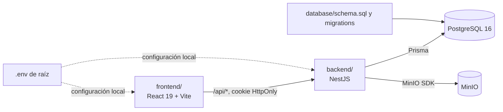

# Arquitectura del monorepo

> Propósito: límites entre paquetes, contrato `/api` y módulos de NestJS.

## Diagrama

En producción, Nginx sirve el frontend compilado y reenvía `/api/*` a NestJS (`frontend/nginx.conf`). En desarrollo, Vite reenvía `/api` a `BACKEND_URL` (por defecto `http://localhost:3000`). El navegador no conoce credenciales de PostgreSQL/MinIO ni se conecta directamente a esos servicios.

## Carpetas

- `frontend/`: React, rutas por rol, estilos, estado y servicios HTTP. Los componentes no conocen Prisma, SQL ni MinIO.
- `backend/`: aplicación NestJS; `modules/` separa dominios, `common/` contiene autenticación, guards e infraestructura, y Prisma mapea el esquema SQL.
- `database/`: `schema.sql` para instalación limpia, `seed.sql` de demostración y migraciones SQL aditivas.
- `docker-compose.yml`: PostgreSQL, MinIO, inicialización del bucket, API NestJS y frontend Nginx en el puerto `5173`. Para desarrollo interactivo, Vite se ejecuta aparte.
- `docs/`: único lugar de documentación para el agente: contratos operativos, arquitectura, flujos institucionales, sistema visual y diagrama de la base de datos (`docs/db-diagram/`).

## Módulos de la API

NestJS es la única implementación de `/api/*`. Cada módulo de `backend/src/modules/` cubre un bloque del contrato:

| Módulo NestJS | Responsabilidad |
| --- | --- |
| `auth` | Registro, login, sesión y solicitudes de registro |
| `users` | Listados y perfiles |
| `submissions` | Entregas, documentos y almacenamiento |
| `admin` | Asignaciones y supervisión administrativa |
| `reviews` | Revisión académica por etapas |
| `stratification` | Estratificación CEISH y Anexo 27 |
| `qualification` | Anexo 12, correcciones y ciclos |
| `annexes` | Emisión y descarga de documentos; generación DOCX en `backend/src/common/annexes/` |

## Datos y seguridad

Los contratos `/api/*` y los nombres que esperan `frontend/src/services/` se mantienen estables. NestJS obtiene los datos con Prisma sobre las tablas existentes. Los cambios de esquema se escriben primero como nueva migración SQL y se reflejan en `database/schema.sql`; no se reescribe una migración ya aplicada.

La autenticación usa contraseña scrypt y cookie firmada HttpOnly. Los guards cargan el rol vigente de PostgreSQL y aplican permisos de ruta; los servicios comprueban además pertenencia a una asignación antes de servir datos o documentos. `CORS_ORIGIN`, `DATABASE_URL`, `SESSION_SECRET` y las credenciales MinIO se configuran desde el entorno, nunca desde variables `VITE_*` públicas.

## Convenciones de módulos

Un controlador define rutas y valida DTOs; un servicio aplica reglas del flujo; Prisma queda en servicios del backend. Mantén respuestas compatibles con los servicios React, reporta errores HTTP claros y evita devolver hashes de contraseñas. Toda consulta de recursos institucionales debe revisar usuario, rol, asignación y estado del flujo.

## Ramas y revisión

Usa ramas `feature/`, `fix/` o `docs/` desde la rama base acordada por el equipo. En el PR describe el issue, alcance, migraciones si las hay y las comprobaciones realizadas. Revisa cambios de frontend/backend juntos si modifican un contrato; los cambios de experiencia visual pueden ir en un PR independiente sin bloquear la API.
